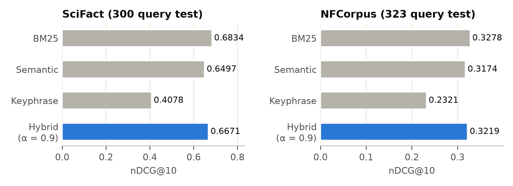
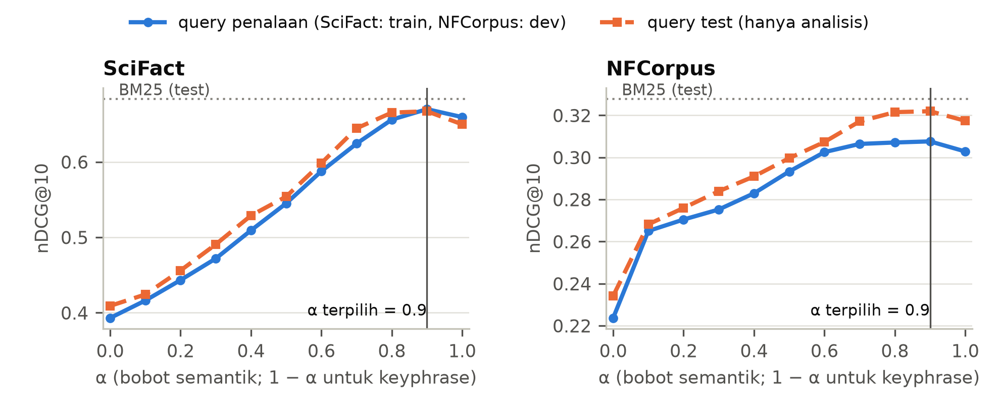
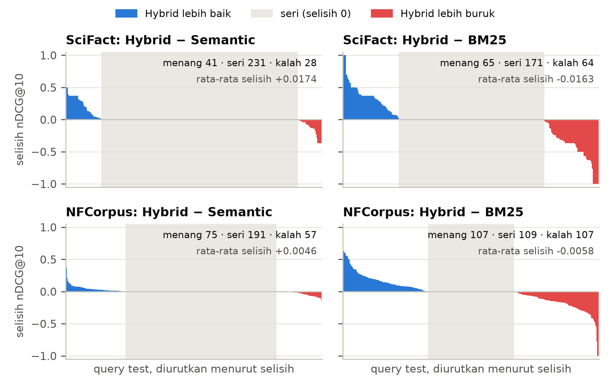

# Analisis UAS: Hybrid Semantic-Keyphrase Retrieval

Dibangkitkan oleh `scripts/analisis_uas.py` dari `results/`, `indexes/`, `artifacts/`, dan `data/`. Jangan diedit tangan; jalankan ulang skripnya.

## Gambar

- `gambar/g1_ndcg10_skenario.png`
- `gambar/g2_pengaruh_alpha.png`
- `gambar/g3_selisih_per_query.png`

## Statistik koleksi

| Koleksi | Dokumen | Split | Query di qrels | Query terpakai* | Pasangan qrels | Rata-rata dok. relevan/query | Peran |
|---|---|---|---|---|---|---|---|
| SciFact | 5183 | test | 300 | 300 | 339 | 1.1 | Evaluasi akhir |
| SciFact | 5183 | train | 809 | 809 | 919 | 1.1 | Penalaan α |
| NFCorpus | 3633 | dev | 324 | 324 | 11385 | 35.1 | Penalaan α |
| NFCorpus | 3633 | test | 323 | 323 | 12334 | 38.2 | Evaluasi akhir |
| NFCorpus | 3633 | train | 2590 | 2590 | 110575 | 42.7 | Tidak dipakai |

*Query terpakai = query yang punya minimal satu dokumen relevan di korpus (`data.usable_queries`). Untuk split penalaan, query yang juga ada di test dikeluarkan.

## Tabel utama (split test)

| Dataset | Skenario | nDCG@10 | MAP@100 | Recall@10 | Recall@100 | P@10 | MRR@10 |
|---|---|---|---|---|---|---|---|
| SciFact | BM25 (pembanding) | 0.6834 | 0.6357 | 0.8312 | 0.9193 | 0.0917 | 0.6416 |
| SciFact | Semantic-only | 0.6497 | 0.6072 | 0.7883 | 0.9250 | 0.0890 | 0.6097 |
| SciFact | Keyphrase-only | 0.4078 | 0.3727 | 0.5346 | 0.7662 | 0.0590 | 0.3749 |
| SciFact | Hybrid (α = 0.9) | 0.6671 | 0.6243 | 0.8073 | 0.9317 | 0.0913 | 0.6241 |
| NFCorpus | BM25 (pembanding) | 0.3278 | 0.1463 | 0.1520 | 0.2484 | 0.2387 | 0.5314 |
| NFCorpus | Semantic-only | 0.3174 | 0.1431 | 0.1569 | 0.3111 | 0.2437 | 0.5083 |
| NFCorpus | Keyphrase-only | 0.2321 | 0.0857 | 0.1004 | 0.1705 | 0.1724 | 0.4200 |
| NFCorpus | Hybrid (α = 0.9) | 0.3219 | 0.1466 | 0.1575 | 0.3137 | 0.2430 | 0.5225 |

## Uji signifikansi (paired bootstrap 10.000×, nDCG@10, Hybrid dikurangi pembanding)

| Dataset | Perbandingan | Selisih rata-rata nDCG@10 | CI 95% | p | n | Signifikan (p < 0.05) |
|---|---|---|---|---|---|---|
| SciFact | Hybrid − Semantic | +0.0174 | [+0.0048, +0.0307] | 0.0060 | 300 | ya |
| SciFact | Hybrid − Keyphrase | +0.2593 | [+0.2141, +0.3035] | 0.0001 | 300 | ya |
| SciFact | Hybrid − BM25 | -0.0163 | [-0.0507, +0.0173] | 0.3538 | 300 | tidak |
| NFCorpus | Hybrid − Semantic | +0.0046 | [+0.0003, +0.0092] | 0.0350 | 323 | ya |
| NFCorpus | Hybrid − Keyphrase | +0.0899 | [+0.0680, +0.1121] | 0.0001 | 323 | ya |
| NFCorpus | Hybrid − BM25 | -0.0058 | [-0.0280, +0.0154] | 0.5902 | 323 | tidak |

Catatan: p = 0.0001 adalah batas bawah (1/10.000), artinya tidak ada satu pun sampel bootstrap yang selisihnya ≤ 0.

## Pengaruh α terhadap nDCG@10

| α | SciFact tune | SciFact test* | NFCorpus tune | NFCorpus test* |
|---|---|---|---|---|
| 0.0 | 0.3931 | 0.4091 | 0.2237 | 0.2341 |
| 0.1 | 0.4162 | 0.4242 | 0.2650 | 0.2682 |
| 0.2 | 0.4433 | 0.4560 | 0.2705 | 0.2760 |
| 0.3 | 0.4719 | 0.4906 | 0.2752 | 0.2839 |
| 0.4 | 0.5092 | 0.5288 | 0.2829 | 0.2910 |
| 0.5 | 0.5450 | 0.5540 | 0.2933 | 0.2996 |
| 0.6 | 0.5876 | 0.5983 | 0.3025 | 0.3073 |
| 0.7 | 0.6242 | 0.6445 | 0.3064 | 0.3171 |
| 0.8 | 0.6560 | 0.6653 | 0.3071 | 0.3215 |
| 0.9 | 0.6699 | 0.6671 | 0.3076 | 0.3219 |
| 1.0 | 0.6593 | 0.6497 | 0.3028 | 0.3174 |

*test = sapuan pada query uji, **hanya untuk analisis**; α dipilih dari kolom tune (nilai tertinggi; seri → paling dekat 0.5).

## Menang / seri / kalah per query (nDCG@10, split test)

| Dataset | Perbandingan | Query | Menang | Seri | Kalah | Seri, keduanya nDCG@10 = 0 | Rata-rata selisih |
|---|---|---|---|---|---|---|---|
| SciFact | Hybrid vs Semantic | 300 | 41 | 231 | 28 | 52 | +0.0174 |
| SciFact | Hybrid vs BM25 | 300 | 65 | 171 | 64 | 29 | -0.0163 |
| SciFact | Hybrid vs Keyphrase | 300 | 151 | 127 | 22 | 50 | +0.2593 |
| NFCorpus | Hybrid vs Semantic | 323 | 75 | 191 | 57 | 97 | +0.0046 |
| NFCorpus | Hybrid vs BM25 | 323 | 107 | 109 | 107 | 75 | -0.0058 |
| NFCorpus | Hybrid vs Keyphrase | 323 | 156 | 111 | 56 | 85 | +0.0899 |

Menang = nDCG@10 Hybrid lebih tinggi pada query itu; seri = sama persis (6 desimal).

## Statistik keyphrase (BART-KPG)

| Statistik | SciFact | NFCorpus |
|---|---|---|
| Rata-rata keyphrase per dokumen | 4.44 | 4.33 |
| Dokumen tanpa keyphrase | 0 | 0 |
| Proporsi keyphrase dokumen *absent* | 0.054 | 0.045 |
| Rata-rata keyphrase per query (test) | 2.92 | 1.89 |
| Query tanpa keyphrase | 0 | 0 |
| Proporsi keyphrase query *absent* | 0.147 | 0.285 |
| Query dengan skor keyphrase 0 untuk semua dokumen | 1 | 32 |
|   … sebagai proporsi query test | 0.003 | 0.099 |
| Median jumlah dokumen dengan skor keyphrase > 0 per query | 155 | 38 |
| Query dengan nDCG@10 Keyphrase-only = 0 | 132 | 133 |
|   … sebagai proporsi query test | 0.440 | 0.412 |
| Query dengan nDCG@10 Semantic-only = 0 (pembanding) | 60 | 100 |
| Rata-rata dokumen relevan per query test | 1.1 | 38.2 |
| Pasangan (query, dokumen relevan) dengan skor keyphrase > 0 | 0.805 | 0.140 |
| Query dengan ≥ 1 dokumen relevan berskor keyphrase > 0 | 245 | 230 |
|   … sebagai proporsi query test | 0.817 | 0.712 |

*Absent* = keyphrase yang setelah `text.normalize_phrase` (huruf kecil, stopword di tepi dibuang, stemming) tidak muncul sebagai urutan kata utuh di judul + abstrak (atau teks query) yang di-`tokenize` dan di-`stem` dengan aturan yang sama.

### Proporsi *absent* menurut urutan keluaran generator

| Urutan ke- | SciFact absent | SciFact n frasa | NFCorpus absent | NFCorpus n frasa |
|---|---|---|---|---|
| 1 | 0.033 | 5183 | 0.025 | 3633 |
| 2 | 0.033 | 5183 | 0.030 | 3633 |
| 3 | 0.052 | 5143 | 0.047 | 3581 |
| 4 | 0.086 | 4316 | 0.072 | 2790 |
| 5 | 0.076 | 2185 | 0.067 | 1307 |
| 6 | 0.087 | 704 | 0.060 | 447 |
| 7 | 0.105 | 190 | 0.074 | 176 |
| 8 | 0.030 | 66 | 0.024 | 84 |
| 9 | 0.222 | 27 | 0.038 | 53 |
| 10 | 0.118 | 17 | 0.036 | 28 |

Urutan akhir (9–10) hanya punya sedikit frasa karena kebanyakan dokumen mendapat < 9 keyphrase; proporsinya tidak stabil.

### Contoh keyphrase dokumen: SciFact (5 dokumen acak, seed 13)

- **[6517267] Barriers and facilitators to implement shared decision making in multidisciplinary sciatica care: a qualitative study**: barriers (1.0); facilitators (0.8); shared decision making (0.67); sciatica (0.57); qualitative study (0.5)
- **[8551160] Mitochondria: Dynamic Organelles in Disease, Aging, and Development**: mitochondria (1.0); disease (0.8); aging (0.67); development (0.57); fusion (0.5); fission (0.44)
- **[11244195] STAR: ultrafast universal RNA-seq aligner.**: rna-seq (1.0); alignment (0.8); splicing (0.67); canonical junctions (0.57); intergenic splices (0.5)
- **[12948892] Ca2+-permeable AMPA receptors regulate growth of human glioblastoma via Akt activation.**: ca2+-permeable ampa receptor (1.0); human glioblastoma (0.8); akt activation (0.67)
- **[14437255] Congruent Visual Speech Enhances Cortical Entrainment to Continuous Auditory Speech in Noise-Free Conditions.**: continuous speech (1.0); audiovisual speech (0.8); multisensory integration (0.67); electroencephalography (0.57); speech perception (0.5, absent)

### Contoh keyphrase dokumen: NFCorpus (5 dokumen acak, seed 13)

- **[MED-2056] Cow's Milk Allergy Is a Major Contributor in Recurrent Perianal Dermatitis of Infants**: cow's milk allergy (1.0); recurrent perianal dermatitis (0.8); infant (0.67)
- **[MED-2207] Growth inhibition and induction of apoptosis in NB4 promyelocytic leukemia cells by trypsin inhibitor from sweet potato storage roots.**: growth inhibition (1.0); apoptosis (0.8); NB4 promyelocytic leukemia cells (0.67); trypsin inhibitor (0.57)
- **[MED-4479] Long-term exposure to sodium nitrite and risk of esophageal carcinoma: a cohort study for 30 years.**: long-term exposure (1.0); sodium nitrite (0.8); esophageal carcinoma (0.67); occupational exposure (0.57)
- **[MED-4484] Salt, processed meat and the risk of cancer.**: salt (1.0); processed meat (0.8); cancer (0.67)
- **[MED-5031] Sleep Habits and Susceptibility to the Common Cold**: sleep (1.0); susceptibility (0.8); common cold (0.67); rhinovirus (0.57)

## Studi kasus

Dipilih otomatis dari `per_query_ndcg10.csv`: *Hybrid menolong* = selisih nDCG@10 Hybrid − Semantic terbesar; *Hybrid kalah dari BM25* = selisih Hybrid − BM25 terkecil (seri diputus menurut id query). ✓ = relevan menurut qrels (angka = tingkat relevansi), ✗ = tidak relevan.

### Hybrid menolong dibanding Semantic: SciFact query 1185

- **Query:** The US health care system can save up to $750 million if 7% of patients waiting for kidney transplants participate in the optimized national kidney paired donation program.
- **Keyphrase query:** kidney paired donation (1.0), optimized national kidney transplantation program (0.8)
- **Dokumen relevan:** 1; selisih nDCG@10 Hybrid − Semantic = +0.5000, Hybrid − BM25 = +0.0000

| Skenario | nDCG@10 | Relevan pertama | #1 | #2 | #3 |
|---|---|---|---|---|---|
| BM25 | 1.0000 | 1 | ✓1 Kidney paired donation and optimizing the use of live donor  | ✗ Successful three-way kidney paired donation with cross-count | ✗ Call to Develop a Standard Acquisition Charge Model for Kidn |
| Semantic | 0.5000 | 3 | ✗ Managing finances of shipping living donor kidneys for donor | ✗ Call to Develop a Standard Acquisition Charge Model for Kidn | ✓1 Kidney paired donation and optimizing the use of live donor  |
| Keyphrase | 0.6309 | 2 | ✗ Successful three-way kidney paired donation with cross-count | ✓1 Kidney paired donation and optimizing the use of live donor  | ✗ Call to Develop a Standard Acquisition Charge Model for Kidn |
| Hybrid | 1.0000 | 1 | ✓1 Kidney paired donation and optimizing the use of live donor  | ✗ Successful three-way kidney paired donation with cross-count | ✗ Call to Develop a Standard Acquisition Charge Model for Kidn |

**Dokumen relevan utama:** [16737210] Kidney paired donation and optimizing the use of live donor organs.  
Keyphrase dokumen: kidney paired donation, optimization, matching algorithms, end-stage renal disease, renal transplantation  
**Penyebab (dari angka):** Dokumen relevan [16737210] ada di peringkat #3 pada Semantic-only dan naik ke #1 pada Hybrid. Keyphrase query dan keyphrase dokumen: frasa yang sama 'kidney paired donation' serta kata yang sama 'kidney', 'paired', 'donation', 'optimized', 'transplantation' (s_kp = 0.667); skor semantiknya 0.592. Sinyal keyphrase menambah skor dokumen ini setelah normalisasi min-max, sehingga peringkatnya naik.

### Hybrid kalah dari BM25: SciFact query 1024

- **Query:** Recurrent mutations occur frequently within CTCF anchor sites adjacent to oncogenes.
- **Keyphrase query:** recurrent mutations (1.0), ctcf anchor sites (0.8), oncogenes (0.67)
- **Dokumen relevan:** 1; selisih nDCG@10 Hybrid − Semantic = +0.0000, Hybrid − BM25 = -1.0000

| Skenario | nDCG@10 | Relevan pertama | #1 | #2 | #3 |
|---|---|---|---|---|---|
| BM25 | 1.0000 | 1 | ✓1 3D Chromosome Regulatory Landscape of Human Pluripotent Cell | ✗ Specific sites in the C terminus of CTCF interact with the S | ✗ Characterization of constitutive CTCF/cohesin loci: a possib |
| Semantic | 0.0000 | 41 | ✗ Characterization of constitutive CTCF/cohesin loci: a possib | ✗ Genome architecture, rearrangements and genomic disorders. | ✗ TRF2 Recruits RTEL1 to Telomeres in S Phase to Promote T-Loo |
| Keyphrase | 0.0000 | >100 | ✗ Reflecting on 25 years with MYC | ✗ MicroRNAs: new tools for diagnosis, prognosis, and therapy i | ✗ Detecting and targeting tumor relapse by its resistance to i |
| Hybrid | 0.0000 | 49 | ✗ Characterization of constitutive CTCF/cohesin loci: a possib | ✗ Reflecting on 25 years with MYC | ✗ Colorectal Cancers from Distinct Ancestral Populations Show  |

**Dokumen relevan utama:** [5373138] 3D Chromosome Regulatory Landscape of Human Pluripotent Cells.  
Keyphrase dokumen: pluripotent cells, transcriptional enhancer, insulator, chia-pet, chromosome structure, gene regulation  
**Penyebab (dari angka):** Dokumen relevan [5373138] ada di peringkat #1 pada BM25 tetapi #49 pada Hybrid (#41 pada Semantic-only). Kata query yang juga muncul di dokumen: 'mutations', 'occur', 'frequently', 'ctcf', 'anchor', 'sites'. Keyphrase query dan keyphrase dokumen: tidak ada frasa maupun kata yang sama (s_kp = 0.000). BM25 memberi bobot tinggi pada kecocokan kata yang langka, sedangkan embedding (s_sem = 0.434, peringkat 41 di seluruh korpus) dan keyphrase tidak menangkapnya cukup kuat.

### Hybrid menolong dibanding Semantic: NFCorpus query PLAIN-681

- **Query:** betel nuts
- **Keyphrase query:** betel nuts (1.0)
- **Dokumen relevan:** 1; selisih nDCG@10 Hybrid − Semantic = +0.3691, Hybrid − BM25 = +0.0000

| Skenario | nDCG@10 | Relevan pertama | #1 | #2 | #3 |
|---|---|---|---|---|---|
| BM25 | 1.0000 | 1 | ✓1 Association between betel-nut chewing and chronic kidney dis | ✗ Diet and prevention of oral cancer: strategies for clinical  | ✗ Nut consumption, vegetarian diets, ischemic heart disease ri |
| Semantic | 0.6309 | 2 | ✗ The role of nuts in the optimal diet: time for a critical ap | ✓1 Association between betel-nut chewing and chronic kidney dis | ✗ Nuts: anti-atherogenic food? |
| Keyphrase | 1.0000 | 1 | ✓1 Association between betel-nut chewing and chronic kidney dis | ✗ Diet and prevention of oral cancer: strategies for clinical  | ✗ A review of the evidence: nuts and body weight. |
| Hybrid | 1.0000 | 1 | ✓1 Association between betel-nut chewing and chronic kidney dis | ✗ The role of nuts in the optimal diet: time for a critical ap | ✗ Nuts: anti-atherogenic food? |

**Dokumen relevan utama:** [MED-5017] Association between betel-nut chewing and chronic kidney disease in men.  
Keyphrase dokumen: betel-nut chewing, chronic kidney disease, men  
**Penyebab (dari angka):** Dokumen relevan [MED-5017] ada di peringkat #2 pada Semantic-only dan naik ke #1 pada Hybrid. Keyphrase query dan keyphrase dokumen: tidak ada frasa yang sama utuh, tetapi ada kata yang sama 'betel', 'nuts' (s_kp = 0.399); skor semantiknya 0.370. Sinyal keyphrase menambah skor dokumen ini setelah normalisasi min-max, sehingga peringkatnya naik.

### Hybrid kalah dari BM25: NFCorpus query PLAIN-1473

- **Query:** kohlrabi
- **Keyphrase query:** kohlrabi (1.0)
- **Dokumen relevan:** 1; selisih nDCG@10 Hybrid − Semantic = +0.0000, Hybrid − BM25 = -1.0000

| Skenario | nDCG@10 | Relevan pertama | #1 | #2 | #3 |
|---|---|---|---|---|---|
| BM25 | 1.0000 | 1 | ✓1 Glucoraphanin and 4-hydroxyglucobrassicin contents in seeds  | - | - |
| Semantic | 0.0000 | >100 | ✗ Hibiscus anthocyanins rich extract-induced apoptotic cell de | ✗ Variability of iodine content in common commercially availab | ✗ Marine edible algae as disease preventers. |
| Keyphrase | 0.0000 | >100 | - | - | - |
| Hybrid | 0.0000 | >100 | ✗ Hibiscus anthocyanins rich extract-induced apoptotic cell de | ✗ Variability of iodine content in common commercially availab | ✗ Marine edible algae as disease preventers. |

**Dokumen relevan utama:** [MED-4455] Glucoraphanin and 4-hydroxyglucobrassicin contents in seeds of 59 cultivars of broccoli, raab, kohlrabi, radish, cauliflower, brussels sprouts, kal...  
Keyphrase dokumen: glucoraphanin, 4-hydroxyglucobrassicin, seeds  
**Penyebab (dari angka):** Dokumen relevan [MED-4455] ada di peringkat #1 pada BM25 tetapi di luar 100 besar pada Hybrid (di luar 100 besar pada Semantic-only). Kata query yang juga muncul di dokumen: 'kohlrabi'. Keyphrase query dan keyphrase dokumen: tidak ada frasa maupun kata yang sama (s_kp = 0.000). BM25 memberi bobot tinggi pada kecocokan kata yang langka, sedangkan embedding (s_sem = 0.112, peringkat 119 di seluruh korpus) dan keyphrase tidak menangkapnya cukup kuat.

### Kandidat lain

| Jenis | Dataset | Query | Hybrid − Semantic | Hybrid − BM25 | Teks query |
|---|---|---|---|---|---|
| Hybrid menolong dibanding Semantic | SciFact | 295 | +0.5000 | +0.0000 | Crosstalk between dendritic cells (DCs) and innate lymphoid cells (ILCs) is impo |
| Hybrid menolong dibanding Semantic | SciFact | 527 | +0.3869 | -0.2441 | Homozygous deletion of murine Sbds gene from osterix-expressing mesenchymal stem |
| Hybrid kalah dari BM25 | SciFact | 1337 | -0.2891 | -1.0000 | Ubiquitin ligase UBC13 generates a K63-linked polyubiquitin moiety at PCNA K164. |
| Hybrid kalah dari BM25 | SciFact | 1363 | +0.0000 | -1.0000 | Venules have a thinner or absent smooth layer compared to arterioles. |
| Hybrid menolong dibanding Semantic | NFCorpus | PLAIN-383 | +0.2080 | +0.1696 | What do you think of Dr. Jenkins' take on paleolithic diets? |
| Hybrid menolong dibanding Semantic | NFCorpus | PLAIN-3191 | +0.1602 | +0.0626 | Is Distilled Fish Oil Toxin-Free? |
| Hybrid kalah dari BM25 | NFCorpus | PLAIN-2081 | +0.0000 | -1.0000 | shelf life |
| Hybrid kalah dari BM25 | NFCorpus | PLAIN-1288 | +0.0000 | -0.7753 | grapes |

## Waktu pencarian per query (komputer lokal)

| Dataset | Skenario / langkah | Query | Rata-rata (ms) | Median (ms) |
|---|---|---|---|---|
| SciFact | Bangun indeks BM25 di memori (5183 dokumen, sekali) | 1 | 692.3 | - |
| SciFact | BM25 | 300 | 0.6 | 0.6 |
| SciFact | Semantic | 300 | 3.8 | 3.6 |
| SciFact | Keyphrase | 300 | 0.4 | 0.4 |
| SciFact | Hybrid | 300 | 4.2 | 3.9 |
| SciFact | BART-KPG query bebas (mps) | 20 | 116.4 | 121.7 |
| NFCorpus | Bangun indeks BM25 di memori (3633 dokumen, sekali) | 1 | 527.2 | - |
| NFCorpus | BM25 | 323 | 0.4 | 0.4 |
| NFCorpus | Semantic | 323 | 4.1 | 3.7 |
| NFCorpus | Keyphrase | 323 | 0.3 | 0.3 |
| NFCorpus | Hybrid | 323 | 4.3 | 4.0 |
| NFCorpus | BART-KPG query bebas (mps) | 20 | 83.1 | 86.9 |

Diukur dengan `HybridRetriever.search(top_k=10)` atas seluruh query test, 3 putaran, setelah 5 query pemanasan. Keyphrase query diambil dari berkas precomputed; untuk query bebas di UI ditambah waktu generasi BART-KPG (baris terakhir tiap dataset). Waktu bergantung pada mesin dan beban saat pengukuran.

## Lingkungan

### Komputer lokal (pengindeksan, pencarian, evaluasi)

| Komponen | Nilai |
|---|---|
| Model Name | MacBook Pro |
| Chip | Apple M4 Pro |
| Total Number of Cores | 12 (8 Performance and 4 Efficiency) |
| Memory | 24 GB |
| macOS | 26.5.1 |
| RAM (sysctl, GB) | 24 |
| CPU (sysctl) | Apple M4 Pro |
| device torch | mps |

| Pustaka | Versi |
|---|---|
| python | 3.14.4 |
| numpy | 2.5.3 |
| scipy | 1.18.1 |
| torch | 2.14.1 |
| transformers | 5.18.0 |
| sentence-transformers | 6.1.0 |
| snowballstemmer | 3.1.1 |
| streamlit | 1.65.0 |
| matplotlib | 3.11.2 |

### Kaggle (pembangkitan keyphrase BART-KPG)

| Dataset | Worker | GPU | torch | transformers | Commit model | Teks | Detik |
|---|---|---|---|---|---|---|---|
| SciFact | 0 | Tesla T4 | 2.11.0+cu128 | 5.16.1 | 674e4b0 | 3144 | 130.1 |
| SciFact | 1 | Tesla T4 | 2.11.0+cu128 | 5.16.1 | 674e4b0 | 3144 | 132.0 |
| NFCorpus | 0 | Tesla T4 | 2.11.0+cu128 | 5.16.1 | 674e4b0 | 3405 | 91.4 |
| NFCorpus | 1 | Tesla T4 | 2.11.0+cu128 | 5.16.1 | 674e4b0 | 3404 | 107.6 |

Model taln-ls2n/bart-base-kp20k, beam 4, top-n 10; entri unik (dokumen + query): SciFact 6288, NFCorpus 6809.
