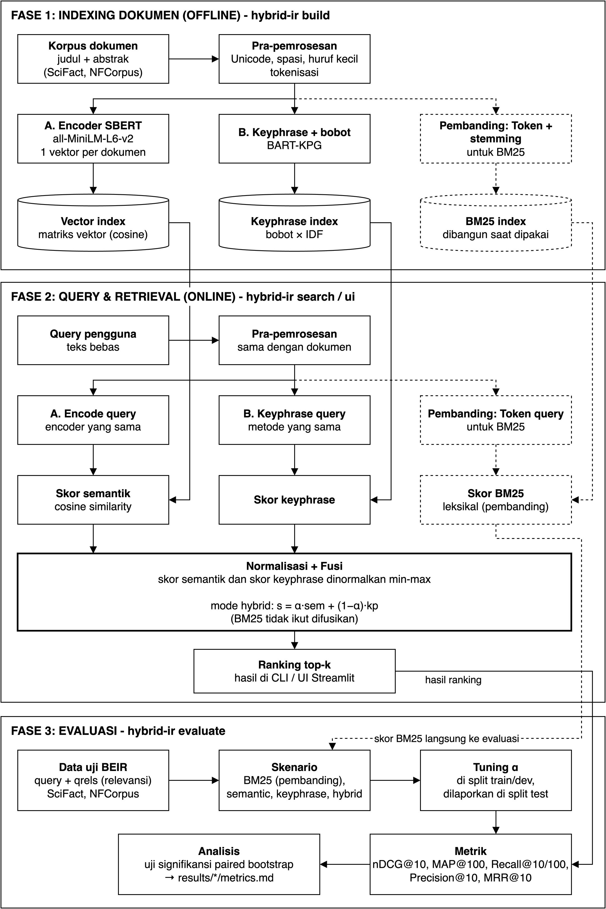

# Bab 02 — Arsitektur pipeline (Gambar 1)

## Tujuan belajar

1. Menjelaskan Gambar 1 kotak demi kotak, dari korpus sampai metrik.
2. Menyebutkan tiga fase sistem dan perintah CLI untuk tiap fase (`build`, `search`/`ui`, `evaluate`).
3. Menjelaskan kenapa garis BM25 putus-putus dan tidak masuk ke kotak fusi.
4. Menunjuk berkas kode yang menjalankan tiap kotak (dengan bantuan `docs/PETA_KODE.md`).

## Gambar 1



Garis dan kotak **penuh** adalah alur utama: jalur A (semantik) dan jalur B (keyphrase) yang digabung. Garis dan kotak
**putus-putus** adalah BM25 sebagai pembanding: skornya langsung masuk ke kotak *Skenario* di Fase 3 dan **tidak**
ikut difusikan. Sumber diagram ada di `docs/Pipeline_V2_laporan.drawio` (bisa dibuka dengan draw.io).

## Fase 1 — Indexing dokumen (offline): `hybrid-ir build`

Dilakukan sekali sebelum pencarian.

| Kotak | Apa yang terjadi | Kode |
|---|---|---|
| Korpus dokumen | baca `corpus.jsonl`; teks dokumen = "judul. abstrak" | `data.load_beir_dir`, `text.make_full_text` |
| Pra-pemrosesan | normalisasi Unicode NFKC, buang karakter kontrol, ratakan spasi | `text.normalize_text` |
| A. Encoder SBERT | all-MiniLM-L6-v2 → 1 vektor 384 dimensi per dokumen, dinormalkan L2 | `encoders.SentenceTransformerEncoder` |
| Vector index | matriks N × 384 disimpan ke `dense.npy` | `indexes.DenseIndex` |
| B. Keyphrase + bobot (BART-KPG) | keyphrase dibangkitkan di **Kaggle 2×T4**, disimpan di `artifacts/keyphrases_*.jsonl` | `kaggle/generate_keyphrases.py`, `keyphrases.PrecomputedKeyphrases` |
| Keyphrase index | keyphrase → unit pencocokan → bobot × IDF, matriks jarang | `indexes.KeyphraseIndex.build` |
| Pembanding: Token + stemming → BM25 index | dibangun **di memori** saat pertama dipakai (sekitar 0.5–0.7 detik), tidak disimpan | `bm25.BM25.fit` |

Hasil `build` adalah folder `indexes/<dataset>_bart/` berisi `dense.npy`, `kp_matrix.npz`, `kp_idf.npy`,
`kp_vocab.json`, `docs.jsonl`, `doc_keyphrases.jsonl`, dan `meta.json`.

## Fase 2 — Query & retrieval (online): `hybrid-ir search` / `hybrid-ir ui`

| Kotak | Apa yang terjadi | Kode |
|---|---|---|
| Query pengguna | teks bebas dari CLI atau UI Streamlit | `cli._cmd_search`, `ui_app.main` |
| Pra-pemrosesan | sama dengan dokumen; kueri kosong atau terlalu panjang ditolak | `HybridRetriever.validate_query` |
| A. Encode query → Skor semantik | encoder yang **sama**, lalu perkalian matriks (cosine) | `DenseIndex.scores` |
| B. Keyphrase query → Skor keyphrase | keyphrase kueri (precomputed atau BART lokal), cosine atas bobot unit | `KeyphraseIndex.scores` |
| Pembanding: Token query → Skor BM25 | hanya dihitung di mode `bm25` | `HybridRetriever.bm25_scores` |
| Normalisasi + Fusi | kandidat = top-100 tiap jalur, min-max, α·sem + (1−α)·kp | `fusion.fuse_weighted` |
| Ranking top-k | daftar hasil + keyphrase yang cocok | `fusion.rank_documents`, `HybridRetriever._make_hit` |

Prinsip penting: **kueri diproses dengan metode yang sama dengan dokumen.** Vektor kueri dan dokumen berasal dari
encoder yang sama, dan keyphrase kueri dipecah menjadi unit dengan aturan yang sama. Kalau tidak sama, skornya tidak
bisa dibandingkan. Karena itu `HybridRetriever.load` menolak indeks yang dibangun dengan encoder berbeda.

<!-- kode: src/hybrid_ir/retriever.py#HybridRetriever.search_many -->
*Kode asli: `src/hybrid_ir/retriever.py`, baris 265–276.*

```python
    def search_many(self, queries: Sequence[str], top_k: int | None = None, mode: str | None = None,
                    alpha: float | None = None) -> list[SearchResult]:
        """Cari banyak query sekaligus. Nilai None berarti pakai nilai di konfigurasi (`retrieval.*`)."""
        r = self.cfg.retrieval
        top_k = r.top_k if top_k is None else top_k
        mode = r.mode if mode is None else mode
        alpha = r.alpha if alpha is None else alpha
        _check_search_args(top_k, mode, alpha)

        sem, kp, bm25, qkps = self._scores_for_mode(queries, mode)
        return [self._hits_for_query(query, mode, alpha, top_k, sem[qi], kp[qi], bm25[qi], qkps[qi])
                for qi, query in enumerate(queries)]
```
<!-- /kode -->

`search_many` melakukan tiga langkah: periksa parameter, hitung skor hanya untuk jalur yang dibutuhkan mode itu
(`_scores_for_mode`), lalu ranking dan susun hasil (`_hits_for_query`).

## Fase 3 — Evaluasi: `hybrid-ir evaluate`

| Kotak | Apa yang terjadi | Kode |
|---|---|---|
| Data uji BEIR | kueri + qrels; split tune (SciFact train, NFCorpus dev) dan test | `evaluation._split_queries` |
| Skenario | BM25 (pembanding), semantic, keyphrase, hybrid | `evaluation._evaluate_scenarios` |
| Tuning α | coba α = 0, 0.1, …, 1 pada kueri tune, pilih nDCG@10 tertinggi | `_alpha_sweep`, `_select_alpha` |
| Metrik | nDCG@10, MAP@100, Recall@10/100, P@10, MRR@10 pada kueri test | `evaluation.query_metrics` |
| Analisis | paired bootstrap: hybrid vs semantic / keyphrase / BM25 | `evaluation.paired_bootstrap` |

<!-- kode: src/hybrid_ir/evaluation.py#run_experiment -->
*Kode asli: `src/hybrid_ir/evaluation.py`, baris 253–282.*

```python
def run_experiment(retriever: HybridRetriever, dataset: Dataset, eval_split: str = "test",
                   tune_split: str | None = None, dev_fraction: float = 0.3,
                   alphas: Sequence[float] | None = None, seed: int = 13) -> tuple[dict, dict[str, dict[str, float]]]:
    """Jalankan seluruh Fase 3 dan kembalikan (hasil untuk metrics.json, nDCG@10 per query per skenario)."""
    alphas = list(alphas) if alphas is not None else [round(a, 2) for a in np.linspace(0, 1, 11)]
    split = _split_queries(dataset, eval_split, tune_split, dev_fraction, seed)
    table = ScoreTable.compute(retriever, split)

    tune_sweep = _alpha_sweep(table, split.tune, split.tune_qrels, alphas)
    alpha_star = _select_alpha(tune_sweep)
    scenarios, per_query_all = _evaluate_scenarios(table, split, alpha_star)
    eval_sweep = _alpha_sweep(table, split.eval, split.eval_qrels, alphas)   # hanya untuk analisis
    sig = _significance_tests(per_query_all, seed)

    result = {
        "dataset": dataset.name,
        "n_docs": len(table.doc_ids),
        "eval_split": eval_split,
        "tune_source": split.source,
        "n_tune_queries": len(split.tune),
        "n_eval_queries": len(split.eval),
        "alpha_selected": alpha_star,
        "alpha_sweep_tune": tune_sweep,
        "alpha_sweep_eval_posthoc": eval_sweep,
        "scenarios": scenarios,
        "significance": sig,
        "index_meta": retriever.meta,
    }
    flat = {name: {q: m["ndcg@10"] for q, m in pq.items()} for name, pq in per_query_all.items()}
    return result, flat
```
<!-- /kode -->

Perhatikan urutannya: α dipilih **sebelum** kueri test disentuh. Sapuan α pada kueri test (`eval_sweep`) baru dihitung
setelahnya, dan hanya untuk analisis.

## Ringkasan

- Tiga fase: **build** (indeks dokumen), **search/ui** (kueri), **evaluate** (empat skenario + uji signifikansi).
- Dua jalur utama digabung (A semantik, B keyphrase); BM25 berjalan sendiri sebagai pembanding.
- Kueri dan dokumen **selalu** diproses dengan metode yang sama.
- Peta lengkap kotak → berkas → fungsi → baris ada di `docs/PETA_KODE.md`.

## Soal latihan

**Soal 1.** Sebutkan tiga fase sistem beserta perintah CLI-nya.

**Soal 2.** Kenapa keyphrase dokumen dibangkitkan di Kaggle, bukan saat `build` di laptop?

**Soal 3.** Apa yang terjadi kalau indeks dibangun dengan encoder A tetapi pencarian memakai encoder B? Bagaimana kode
mencegahnya?

**Soal 4.** Pada mode `hybrid`, jalur mana saja yang dihitung oleh `_scores_for_mode`? Bagaimana dengan mode `bm25`?

**Soal 5.** Kenapa sapuan α pada kueri test tidak boleh dipakai untuk memilih α?

## Kunci jawaban

**Jawaban 1.** Fase 1 indexing: `hybrid-ir build`. Fase 2 query & retrieval: `hybrid-ir search` atau `hybrid-ir ui`.
Fase 3 evaluasi: `hybrid-ir evaluate`.

**Jawaban 2.** BART-KPG adalah model *sequence-to-sequence* yang berat. Membangkitkan keyphrase untuk 6.288 teks
(SciFact) dan 6.809 teks (NFCorpus) jauh lebih cepat di GPU T4: sekitar 91–132 detik per GPU. Hasilnya disimpan sebagai
berkas JSONL dan dibaca lokal (`method: precomputed`).

**Jawaban 3.** Vektor dari dua encoder berbeda tidak sebanding, sehingga skor cosine-nya tidak bermakna.
`HybridRetriever.load` membandingkan `encoder.fingerprint()` dengan `meta.json` dan melempar `IndexMismatchError` bila
berbeda.

**Jawaban 4.** Mode `hybrid` menghitung jalur A (semantik) dan B (keyphrase), sedangkan BM25 diisi nol. Mode `bm25`
hanya menghitung BM25; jalur A dan B diisi nol.

**Jawaban 5.** Kalau α dipilih dari kueri test, kita "mengintip" data uji, sehingga hasil test menjadi terlalu optimis
dan tidak adil. α harus dipilih dari kueri tune, lalu dilaporkan pada kueri test yang belum pernah dipakai.
