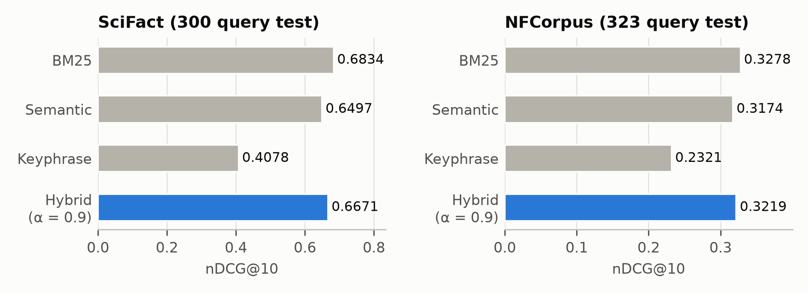
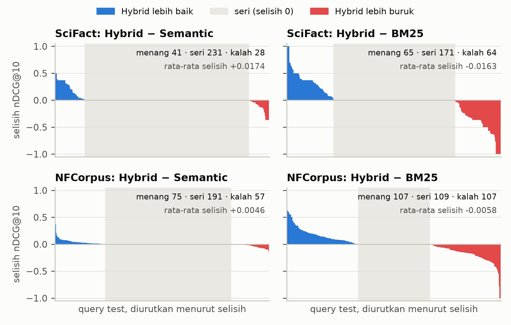
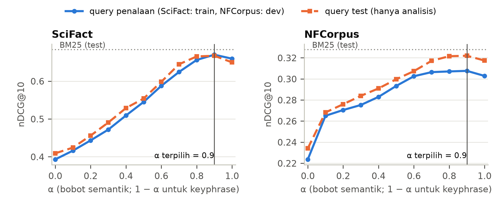

# Bab 09 — Hasil dan cara membacanya

Semua tabel dan grafik di bab ini dibangkitkan oleh `scripts/analisis_uas.py` dari `results/`, `indexes/`, dan
`artifacts/`. Versi lengkap ada di `analisis/README.md`.

## Tujuan belajar

1. Membaca tabel utama dan menyebut tiga temuan pokok tanpa melihat catatan.
2. Membaca tabel uji signifikansi dan menjelaskan arti "signifikan" dan "tidak signifikan".
3. Membaca grafik α, grafik selisih per kueri, dan statistik keyphrase.
4. Menceritakan dua studi kasus: satu ketika hybrid menolong, satu ketika hybrid kalah dari BM25.

## 1. Tabel utama (split test)

| Koleksi | Skenario | nDCG@10 | MAP@100 | R@10 | R@100 | P@10 | MRR@10 |
|---|---|---|---|---|---|---|---|
| SciFact | BM25 (pembanding) | **0.6834** | **0.6357** | **0.8312** | 0.9193 | **0.0917** | **0.6416** |
| | Semantic-only | 0.6497 | 0.6072 | 0.7883 | 0.9250 | 0.0890 | 0.6097 |
| | Keyphrase-only | 0.4078 | 0.3727 | 0.5346 | 0.7662 | 0.0590 | 0.3749 |
| | Hybrid (α = 0.9) | 0.6671 | 0.6243 | 0.8073 | **0.9317** | 0.0913 | 0.6241 |
| NFCorpus | BM25 (pembanding) | **0.3278** | 0.1463 | 0.1520 | 0.2484 | 0.2387 | **0.5314** |
| | Semantic-only | 0.3174 | 0.1431 | 0.1569 | 0.3111 | **0.2437** | 0.5083 |
| | Keyphrase-only | 0.2321 | 0.0857 | 0.1004 | 0.1705 | 0.1724 | 0.4200 |
| | Hybrid (α = 0.9) | 0.3219 | **0.1466** | **0.1575** | **0.3137** | 0.2430 | 0.5225 |

Tiga temuan pokok:

1. **Hybrid > semantic > keyphrase** di kedua koleksi. Menambah keyphrase ke embedding menaikkan nDCG@10.
2. **BM25 sedikit lebih tinggi** daripada hybrid pada nDCG@10 (selisih 0.0163 dan 0.0058).
3. **Hybrid punya Recall@100 tertinggi** di kedua koleksi, tetapi selisihnya kecil dan tidak diuji signifikansinya.

## 2. Signifikansi dan menang/seri/kalah

| Koleksi | Perbandingan | Selisih | CI 95% | p | Menang / seri / kalah |
|---|---|---|---|---|---|
| SciFact | hybrid − semantic | +0.0174 | [+0.0048, +0.0307] | 0.006 | 41 / 231 / 28 |
| | hybrid − keyphrase | +0.2593 | [+0.2141, +0.3035] | < 0.001 | 151 / 127 / 22 |
| | hybrid − BM25 | −0.0163 | [−0.0507, +0.0173] | 0.354 | 65 / 171 / 64 |
| NFCorpus | hybrid − semantic | +0.0046 | [+0.0003, +0.0092] | 0.035 | 75 / 191 / 57 |
| | hybrid − keyphrase | +0.0899 | [+0.0680, +0.1121] | < 0.001 | 156 / 111 / 56 |
| | hybrid − BM25 | −0.0058 | [−0.0280, +0.0154] | 0.590 | 107 / 109 / 107 |

Cara membaca Gambar 3: setiap batang adalah satu kueri test, diurutkan dari selisih terbesar. Biru berarti hybrid
lebih baik, merah berarti hybrid lebih buruk, dan area abu-abu adalah kueri yang nDCG@10-nya sama.

- **Hybrid vs semantic**: sebagian besar kueri **seri** (231 dari 300 di SciFact). Keyphrase hanya mengubah hasil pada
  sebagian kecil kueri, tetapi lebih sering menolong daripada merugikan (41 vs 28), sehingga rata-ratanya naik secara
  signifikan meskipun kecil.
- **Hybrid vs BM25**: menang dan kalah hampir sama banyak (65 vs 64; 107 vs 107), dan selisihnya kadang besar ke dua
  arah. Inilah kenapa rata-ratanya tidak signifikan.
- Ingat: "tidak signifikan" bukan "terbukti setara".

## 3. Pengaruh α

- Kurva **biru** (kueri penalaan) naik dari α = 0 dan memuncak di **α = 0.9** (0.6699 SciFact, 0.3076 NFCorpus), lalu
  turun di α = 1 (semantik saja: 0.6593 dan 0.3028).
- Artinya, semantik tetap dominan, dan keyphrase dengan bobot kecil (0.1) berguna sebagai penentu.
- Bobot keyphrase yang besar merugikan: di α = 0.5, nDCG@10 penalaan hanya 0.5450 dan 0.2933.
- NFCorpus datar di α = 0.7–0.9 (rentang 0.0012), jadi pilihan α di sekitar situ tidak sensitif.
- Kurva **oranye putus-putus** (kueri test) hanya untuk analisis. Bentuknya mirip kurva biru, sehingga α hasil penalaan
  "berpindah" dengan baik ke data uji.

## 4. Statistik keyphrase

| Statistik | SciFact | NFCorpus |
|---|---|---|
| Keyphrase per dokumen | 4.44 | 4.33 |
| Keyphrase per kueri | 2.92 | 1.89 |
| Keyphrase dokumen *absent* | 5.4% | 4.5% |
| Keyphrase kueri *absent* | 14.7% | 28.5% |
| Dokumen relevan per kueri | 1.1 | 38.2 |
| Pasangan kueri–dokumen relevan berskor keyphrase > 0 | 80.5% | 14.0% |
| Kueri dengan ≥ 1 dokumen relevan berskor keyphrase > 0 | 81.7% | 71.2% |
| Kueri tanpa skor keyphrase sama sekali | 0.3% | 9.9% |
| Kueri dengan nDCG@10 keyphrase saja = 0 | 44.0% | 41.2% |

Pesan utamanya (lihat Bab 05 untuk penjelasan):

- Keyphrase hampir selalu disalin dari teks (sekitar 95% *present*), jadi perannya sebagai penguat istilah inti.
- Sinyal keyphrase **jarang**: keyphrase saja gagal total (nDCG@10 = 0) di lebih dari dua perlima kueri. Itulah
  kenapa keyphrase saja lemah dan bobotnya kecil di fusi.
- Angka 14.0% di NFCorpus dipengaruhi qrels yang padat; per kueri angkanya 71.2%.

## 5. Studi kasus

| Jenis | Kueri | BM25 | Semantik | Keyphrase | Hybrid | Kecocokan keyphrase |
|---|---|---|---|---|---|---|
| Hybrid menolong | SciFact 1185 (*kidney paired donation*) | 1 | 3 | 2 | **1** | frasa sama: kidney paired donation |
| Hybrid menolong | NFCorpus PLAIN-681 "betel nuts" | 1 | 2 | 1 | **1** | kata sama: betel, nuts |
| Hybrid kalah dari BM25 | SciFact 1024 (*CTCF anchor sites*) | **1** | 41 | – | 49 | tidak ada |
| Hybrid kalah dari BM25 | NFCorpus PLAIN-1473 "kohlrabi" | **1** | – | – | – | tidak ada |

Angka di kolom adalah peringkat dokumen relevan utama; "–" berarti di luar 100 teratas.

**Hybrid menolong, 1185.** Semantik saja menaruh dokumen tentang pendanaan pengiriman ginjal di peringkat 1, karena
maknanya dekat. Dokumen relevan berbagi frasa "kidney paired donation" dengan kueri, sehingga naik ke peringkat 1
(hitungan lengkap di Bab 07).

**Hybrid menolong, "betel nuts".** Semantik saja menaruh artikel tentang kacang secara umum (*The role of nuts in the
optimal diet*) di atas. Keyphrase dokumen relevan "betel-nut chewing" memuat kata "betel" dan "nuts", sehingga dokumen
relevan naik ke peringkat 1.

**Hybrid kalah, 1024 (CTCF).** Kata langka "CTCF" dan "anchor" muncul persis di dokumen relevan, sehingga BM25 menaruhnya
di peringkat 1. Embedding menaruhnya di peringkat 41, dan keyphrase dokumen ('pluripotent cells', 'chromosome
structure', 'gene regulation', …) tidak berbagi kata dengan keyphrase kueri. Ini contoh kelemahan *dense retriever* pada
istilah langka (Chen dkk. [6]).

**Hybrid kalah, "kohlrabi".** Kata "kohlrabi" tertulis di judul dokumen relevan, tetapi BART-KPG hanya membangkitkan tiga
keyphrase ('glucoraphanin', '4-hydroxyglucobrassicin', 'seeds'). Jalur keyphrase buta terhadap dokumen ini, dan embedding
juga tidak menaruhnya di 100 teratas. Pelajarannya: keyphrase yang dibangkitkan tidak selalu mencakup semua istilah
penting.

## Ringkasan

- Hybrid unggul signifikan atas semantic (p = 0.006 dan 0.035) dan keyphrase (p < 0.001).
- BM25 sedikit lebih tinggi, tetapi tidak signifikan (p = 0.354 dan 0.590), dan menang/kalah per kueri imbang.
- α = 0.9: semantik dominan, keyphrase sebagai penentu kecil.
- Keyphrase berguna saat istilah intinya cocok; gagal saat istilah penting tidak terangkut ke keyphrase.

## Soal latihan

**Soal 1.** Sebutkan tiga temuan pokok dari tabel utama.

**Soal 2.** Hybrid lebih baik dari semantic di SciFact dengan p = 0.006, tetapi 231 dari 300 kueri seri. Bagaimana
keduanya bisa benar sekaligus?

**Soal 3.** Kenapa kurva oranye di Gambar 4 tidak dipakai untuk memilih α?

**Soal 4.** Ceritakan kenapa hybrid gagal pada kueri "kohlrabi".

## Kunci jawaban

**Jawaban 1.** (1) Hybrid > semantic > keyphrase di kedua koleksi. (2) BM25 sedikit lebih tinggi daripada hybrid, tetapi
tidak signifikan. (3) Hybrid punya Recall@100 tertinggi (selisihnya kecil dan tidak diuji).

**Jawaban 2.** Uji signifikansi melihat selisih per kueri. Pada kueri yang berubah, hybrid lebih sering menang (41)
daripada kalah (28), dan pola itu konsisten di sampel bootstrap. Seri tidak menambah atau mengurangi selisih, sehingga
rata-ratanya kecil (+0.0174) tetapi tetap positif secara konsisten.

**Jawaban 3.** Kurva oranye memakai kueri test. Memilih α dari situ berarti mengintip data uji, sehingga hasilnya
terlalu optimis. α dipilih dari kurva biru (kueri penalaan).

**Jawaban 4.** BART-KPG hanya membangkitkan tiga keyphrase untuk dokumen relevan, dan tidak satu pun memuat "kohlrabi",
jadi skor keyphrase-nya nol. Embedding juga tidak menaruh dokumen itu di 100 besar. Hanya BM25 yang menemukannya, karena
kata "kohlrabi" tertulis persis di judul.
